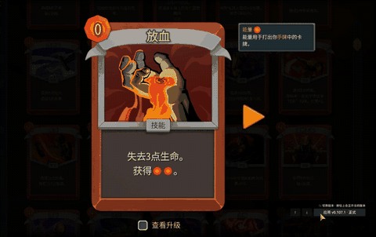

<div align="center">


# 卡牌时光机 · Card Time Machine

**把被削的卡，切回你喜欢的那个版本。**

[](../../releases)
[](#安装)
[](https://store.steampowered.com/app/2868840/)
[](https://steamcommunity.com/sharedfiles/filedetails/?id=3783150604)
[](#授权--license)

[简体中文](#简体中文) · [English](#english)

</div>

---

## 简体中文

### 这是什么

《卡牌时光机》是一个《杀戮尖塔 2》的民间平衡回退模组。

它不覆盖整个游戏版本，而是**一张卡一张卡地**把卡牌切回官方历史版本中的任意一版：

- 同一张卡，可以单独选择 `v0.98.3`、`v0.99.1`、`v0.103.2`、`v0.103.3`、`v0.107.1`、`v0.111.1`、`v0.113.1`、`v0.114.0`；
- 只列出**真正发生过变化**的版本；几个版本效果完全一样时，只保留最新那个，不拿重复项凑数；
- 没被改过的卡不会出现在列表里，避免设置页变成一片无意义的版本号。

一句话：安东尼削他的，你玩你的。

### 当前版本

- **稳定版 `v1.2.8`**：默认推荐，包含 8 版本逐卡回退、卡池排除、预设排除表、违逆/摧残等 13 张卡旧版升级数值修复，以及 1.2.8 的迷雾/跟踪/同步/幻景/叽诗句旧版本补全（叽诗句升级 2 层已修复）。下载 [`CardTimeMachine-1.2.8.zip`](CardTimeMachine-1.2.8.zip)，对应的 Release 是 [`v1.2.8`](../../releases/tag/v1.2.8)。
- **旧稳定版 `v1.0.6`**：只做逐卡版本回退，保留归档，不再作为默认下载。

两个包二选一安装，不要同时放进 `mods`。需要 **BaseLib** 和 **CVC - 跨版本兼容补丁** 两个前置，缺一不可。

### 效果演示



在卡牌百科里点开一张卡，翻开大卡面，用 **↑ / ↓**（或右下角按钮）切换版本，卡面的费用、数值、关键词和描述会一起变化；确认后点 **「应用 当前版本」**。

### 八个版本

| 版本 | 分支 | 说明 |
|---|---|---|
| `v0.98.3` | public | 早期公开版本 |
| `v0.99.1` | public | 早期公开版本；与 0.98.3 相同效果的卡会折叠到这一版 |
| `v0.103.2` | public | 中期公开版本 |
| `v0.103.3` | public | 中期公开版本 |
| `v0.107.1` | public | **7 月 3 日删掉「燃料抽牌」之前的最后一版**；压缩 + 燃料抽牌的巅峰形态 |
| `v0.111.1` | public | 愚者上线前的最后一版正式版 |
| `v0.113.1` | public-beta | **愚者首版**；哇啾叽、愚者塔罗的初版数值 |
| `v0.114.0` | public-beta | 当前测试版；也是本模组运行的游戏版本 |

> 「压缩抽牌」：`压缩` 把状态牌变成 `燃料`，`燃料` 在 `v0.107.1` 及更早版本是 **0 费、消耗、给 1 能量并抽 1 张牌（升级抽 2）**。7 月 3 日之后官方删掉了抽牌，所以只有旧版本才有这个效果。

### 功能

- **卡牌百科内预览**：不用改配置就能先看旧版长什么样；数值、费用、关键词、描述都会跟着切。
- **逐卡选择**：每张卡独立记录，互不影响；切完立即生效。
- **按职业分组**：设置页按铁甲战士、静默猎手、故障机器人、观者、死灵之缚、储君、愚者等职业分组。
- **搜索**：卡名或 slug 搜索，200+ 张多版本卡里快速定位。
- **整套预设**：一键应用「正式版 0.111.1」「愚者首版 0.113.1」「压缩抽牌 0.107.1」等组合。
- **卡池排除**：在百科详情页把任意卡标记为「已排除」，之后它不再出现在卡牌奖励、商店和随机生成里；已有卡组不会被改动。
- **历代最强（自动）**：按费用、伤害、格挡、抽牌、能量、关键词等维度给每个版本打分，自动选一套；也可以把自己调好的组合另存为预设。
- **不改存档结构**：只改运行时卡牌数据和描述；仍建议备份存档。

### 安装

1. 在 Steam 创意工坊订阅 **BaseLib**（物品 ID `3737335127`）和 **CVC - 跨版本兼容补丁**（物品 ID `3783150604`）。两个都要，缺一不可。
2. 下载 [`CardTimeMachine-1.2.8.zip`](CardTimeMachine-1.2.8.zip)。
3. 解压后把整个 `CardTimeMachine` 文件夹放进游戏的 `mods` 目录：

   ```text
   ...\Slay the Spire 2\mods\CardTimeMachine\
       CardTimeMachine.dll
       CardTimeMachine.pck
       CardTimeMachine.json
   ```

4. 启动游戏。进入 **卡牌百科**，点开一张有旧版本的卡即可预览；设置页会出现「卡牌时光机」的配置入口。

> 旧稳定版 [`CardTimeMachine-1.0.6.zip`](CardTimeMachine-1.0.6.zip) 仍保留在仓库里，但它没有卡池排除，也没有 1.2.x 的升级数值修复；新安装请直接用 1.2.3。

### 使用

**逐卡切换**

1. 打开 **卡牌百科**（Card Library）。
2. 点一张卡，进入大卡面。
3. 按 **↑ / ↓**，或点右下角的上下按钮，切换版本。
4. 看卡面确认数值/描述后，点 **「应用 当前版本」**。
5. 重启游戏后选择仍然保留。

**批量切换**

1. 打开 **设置 → 模组 → 卡牌时光机**。
2. 顶部选择预设：`历代最强（自动）`、`正式版 0.111.1`、`愚者首版 0.113.1`、`压缩抽牌（v0.107.1）`。
3. 或者用搜索框找卡，逐行改下拉框。
4. 想保存自己的组合，点「另存为…」起个名字；下次直接从预设下拉里选。

配置文件在：

```text
...\Slay the Spire 2\mods\CardTimeMachineConfig.json
```

删掉这个文件即可恢复全部默认（当前版本）。

### 版本选择逻辑

- 只比较**卡牌数据 + 行为**：费用、类型、稀有度、目标、伤害/格挡/抽牌等变量、关键词、升级效果、`OnPlay` 命令序列。
- 数据和行为都相同的版本会折叠，只显示最新一个正式版；所以不是每张卡都有 8 个选项。
- 被官方删除的卡（例如 `RapidShot`）不会复活；只处理当前版本仍存在的卡。
- 预览时只改显示，不写配置；点「应用」才会写入。

### 常见问题

**为什么有些卡只有两三个版本？**

因为它在其它版本没有变化。模组不会给没改过的卡硬塞版本选项；折叠后只保留最新一个等价版本。

**为什么选了 0.98.3，列表里显示的是 0.99.1？**

这两版对这张卡的效果完全一样，按规则折叠到较新的 `v0.99.1`，避免重复项。

**为什么描述是英文/旧文案？**

0.98/0.99 的旧本地化并不完整。能取到旧文案就显示旧文案，取不到时回退到最接近的可用文本；数值仍然是旧版的。遇到明显错位可以带卡名 + 版本提 issue。

**升级后的效果不对？**

旧版的 `OnUpgrade`、Power 类、关键词移除都可能和新版不同。已经为已知差异写了补丁；如果还有卡不对，请告诉我：卡名、选择的版本、是否升级、期望效果和实际效果。

**多人模式能用吗？**

未测试。模组改的是本地卡牌行为；联机前请自行评估风险，最好先备份存档。

**会影响成就吗？**

《杀戮尖塔 2》的成就系统仍在变化；本模组没有针对成就做专门处理，介意的话先用无模组存档测试。

**和其它模组冲突吗？**

可能。尤其是同样修改卡牌数据/描述/关键词的模组；冲突时以加载顺序和具体补丁为准，不保证兼容。

### 注意

- 游戏版本：`v0.114.0`，`public-beta` 分支。正式版 `v0.111.1` 没有愚者，部分卡不存在；当前 DLL 也不能在 0.111.1 加载。
- 依赖 **BaseLib** 和 **CVC - 跨版本兼容补丁**；两个都缺一不可，缺少基座时设置页不会出现或模组加载失败。
- 本模组会修改卡牌数据和运行时行为，**不会主动改你的存档文件**；仍建议备份。
- 卡池排除是「软禁用」：不删除卡、不改已有卡组，只影响后续奖励/商店/随机生成；少数事件/遗物硬编码仍可能给卡。开发者控制台 `card <ID>` 也仍能加。
- 作者仍在读博，更新不一定及时；遇到问题请尽量带上日志和复现步骤。

### 更新日志

见 [CHANGELOG.md](CHANGELOG.md)。

### 致谢

- **jiegec / Revert Anthony**：最早的逐卡回退模组与架构；本项目的部分旧实现参考/改编自它：<https://github.com/jiegec/STS2RevertAnthony>
- **BaseLib**：设置页与模组基础设施。
- **Mega Crit**：《杀戮尖塔 2》。
- 所有帮忙测试、报卡名和版本的朋友。

### 授权 / License

本仓库**不提供开源许可证**；发布包仅供个人游玩。第三方代码、游戏文本与素材归各自作者所有。如果你是权利方，希望删除或调整署名，请开 issue。

---

## English

### What it is

**Card Time Machine** is an unofficial balance-rollback mod for **Slay the Spire 2**.

Instead of downgrading the whole game, it lets you roll back **individual cards** to any of eight official balance versions:

`v0.98.3` · `v0.99.1` · `v0.103.2` · `v0.103.3` · `v0.107.1` · `v0.111.1` · `v0.113.1` · `v0.114.0`

Only versions in which a card **actually changed** are listed. If several versions behave identically, they are folded into the newest one, so the list stays short and meaningful.

### Current release

- **Stable `v1.2.8`** — the default recommendation: eight-version card rollback, card-pool exclusion, preset bans, the old-upgrade-value fixes for Defy, Debilitate and 11 other cards, plus the 1.2.8 old-version coverage for Haze, Tracking, Synchronize, Eidolon and Ki Verse (including the Ki Verse upgrade fix). Download [`CardTimeMachine-1.2.8.zip`](CardTimeMachine-1.2.8.zip); the matching release is [`v1.2.8`](../../releases/tag/v1.2.8).
- **Archived stable `v1.0.6`** — card rollback only. Kept for reference; not the default download.

Install one package or the other, not both. Requires **BaseLib** and **CVC - Cross-Version Compatibility**; the mod will not load correctly without both.

### Features

- **Live preview in the card library** — open a card, use **↑ / ↓**, and see its cost, numbers, keywords and description change before applying.
- **Per-card choice** — every card remembers its own version in `CardTimeMachineConfig.json`.
- **Settings grouped by class** — Ironclad, Silent, Defect, Watcher, Necrobinder, Regent, Fool and others.
- **Search, presets and “Strongest”** — apply a whole combination, save your own preset, or let the mod score every version and pick the strongest.
- **Historical highlights** — the pre-July **Compact + Fuel draw** version (`Fuel` at `v0.107.1`), the first Fool build (`v0.113.1`), and many other nerfed cards.
- **Card-pool exclusion** — mark any card as excluded in its library detail view; it then stops appearing in card rewards, shops and random generation. Existing decks are untouched.
- **No save-file rewriting** — card data and behaviour only; back up your saves anyway.

### Install

1. Subscribe to **BaseLib** (`3737335127`) and **CVC - Cross-Version Compatibility** (`3783150604`) on the Steam Workshop. Both are required.
2. Download [`CardTimeMachine-1.2.8.zip`](CardTimeMachine-1.2.8.zip).
3. Extract the `CardTimeMachine` folder into:

   ```text
   ...\Slay the Spire 2\mods\CardTimeMachine\
       CardTimeMachine.dll
       CardTimeMachine.pck
       CardTimeMachine.json
   ```

4. Launch the game. Open the **Card Library**, click a card, and use **↑ / ↓** on the large card view. The mod's settings page is under **Settings → Mods → Card Time Machine**.

> The archived [`CardTimeMachine-1.0.6.zip`](CardTimeMachine-1.0.6.zip) is still in the repository, but it lacks card-pool exclusion and the 1.2.x upgrade fixes. New installs should use 1.2.3.

### Usage

- **Single card:** Card Library → click a card → **↑ / ↓** → **Apply this version**.
- **Batch:** Settings → Mods → Card Time Machine → choose a preset, or search and change individual dropdowns.
- **Presets:** `Strongest (auto)`, `v0.111.1`, `v0.113.1`, `Compact draw (v0.107.1)`, or save your own.

### Version selection rules

- The mod compares card **data and behaviour**: cost, type, rarity, target, damage/block/draw variables, keywords, upgrade effects and the `OnPlay` command sequence.
- Identical versions are folded into the newest one; that is why not every card has eight options.
- Cards removed by the developers are not resurrected.
- Previewing a version does not write the config; only **Apply** does.

### Notes

- Built for **Slay the Spire 2 v0.114.0** on the `public-beta` branch. The current DLL cannot load on the v0.111.1 public branch (it lacks the Fool cards and several Power types).
- Requires **BaseLib** and **CVC - Cross-Version Compatibility**; both are mandatory.
- **Multiplayer is untested.** Use at your own risk.
- Card-pool exclusion is a **soft ban**: it does not delete cards or change existing decks, and only affects future rewards, shops and random generation. A few hard-coded events/relics and the dev console `card <ID>` can still create the card.
- Very old versions (`v0.98.3` / `v0.99.1`) do not have complete localized descriptions in every language; the mod falls back to the closest available text while keeping the old numbers.
- Other card-data/description mods may conflict.

### Credits

- **jiegec / Revert Anthony** — the original per-card revert mod and architecture; some old implementations were adapted from it: <https://github.com/jiegec/STS2RevertAnthony>
- **BaseLib** — config UI and mod plumbing.
- **Mega Crit** — Slay the Spire 2.
- Everyone who tested early builds and reported card-specific bugs.

### License

No open-source license is granted for this repository. The packaged mod is provided for personal play. Third-party code, game text and assets remain the property of their respective authors. If you are a rights holder and want something removed or credited differently, please open an issue.

---

<div align="center">


**复活吧，我的爱卡。**

`KILL THE NERF · BRING THEM BACK`

</div>
